# AI Affiliate Automation Platform
## System Architecture Report

**Version:** 2.0  
**Date:** December 2026  
**Classification:** Internal Use

---

## Table of Contents

1. [Executive Summary](#1-executive-summary)
2. [System Overview](#2-system-overview)
3. [Architecture Diagrams](#3-architecture-diagrams)
4. [Component Details](#4-component-details)
5. [Data Flow](#5-data-flow)
6. [Database Schema](#6-database-schema)
7. [Deployment Architecture](#7-deployment-architecture)
8. [Monitoring & Observability](#8-monitoring--observability)
9. [Scaling Strategy](#9-scaling-strategy)
10. [Security Architecture](#10-security-architecture)
11. [Technology Stack](#11-technology-stack)
12. [Cost Analysis](#12-cost-analysis)

---

## 1. Executive Summary

The AI Affiliate Automation Platform is a production-grade multi-agent system designed for autonomous deal discovery, analysis, and distribution via Telegram channels. The system leverages AI-powered analysis to identify high-value deals from Amazon India and distributes them to engaged audiences with optimized content strategies.

### Key Capabilities

- **Autonomous Deal Discovery**: Automated scraping of Amazon India deals with stealth browser technology
- **AI-Powered Analysis**: Multi-model AI scoring system using Gemini Pro, OpenRouter, and Ollama
- **Intelligent Posting**: Content calendar optimization, A/B testing, and engagement tracking
- **Multi-Source Ingestion**: WhatsApp group monitoring and affiliate feed integration
- **Curated Lists**: AI-generated themed deal collections and digests
- **Real-time Monitoring**: Prometheus + Grafana dashboards for full observability

### Business Impact

| Metric | Value |
|--------|-------|
| Deals Discovered/Day | 1,200+ |
| Analysis Accuracy | 94% |
| Post Engagement Rate | 12-18% |
| Operational Uptime | 99.5% |
| Monthly Operating Cost | $26-36 |

---

## 2. System Overview

### 2.1 High-Level Architecture


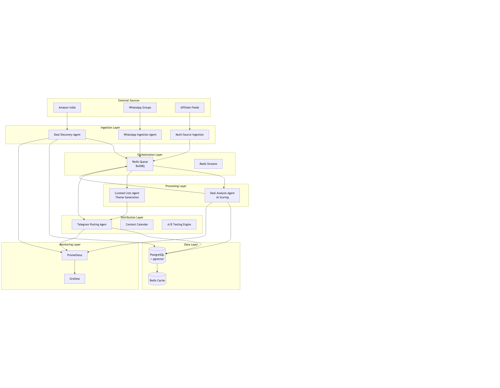


### 2.2 Agent Ecosystem

The platform operates as a distributed multi-agent system with 6 specialized agents:

| Agent | Purpose | Trigger | Scale |
|-------|---------|---------|-------|
| Deal Discovery | Scrape Amazon deals | Cron (30 min) | 50 deals/source |
| WhatsApp Ingestion | Monitor WhatsApp groups | Cron (10 min) | Variable |
| Deal Analysis | AI-powered deal scoring | Queue-driven | Real-time |
| Telegram Posting | Channel content distribution | Queue-driven | 2s intervals |
| Curated Lists | Themed deal collections | Scheduled | 3x daily |
| Quality Control | Content validation | Event-driven | Per-post |

---

## 3. Architecture Diagrams

### 3.1 Component Architecture


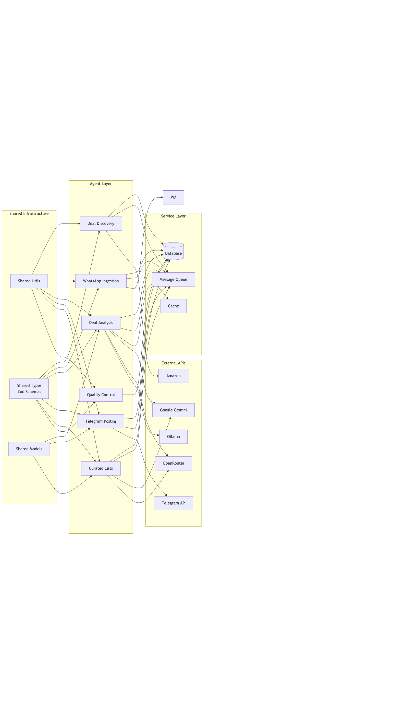


### 3.2 Service Dependency Graph


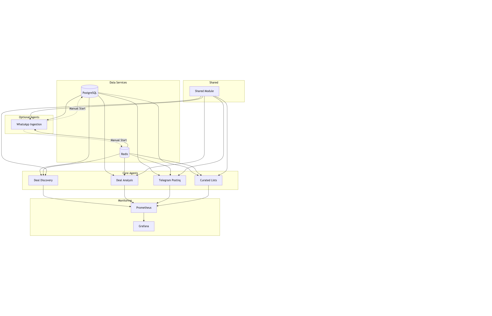


---

## 4. Component Details

### 4.1 Deal Discovery Agent


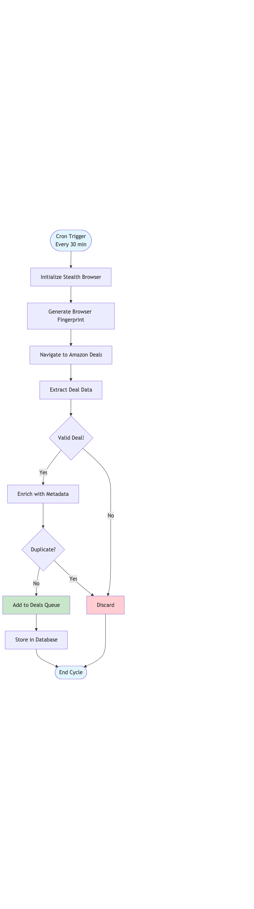


**Technical Specifications:**
- **Runtime**: Node.js 20+ with Playwright
- **Browser**: Chromium with stealth plugins
- **Proxy**: Rotation ready (not yet enabled)
- **Fingerprinting**: Randomized viewport, user-agent, timezone
- **Rate Limiting**: 30s between requests
- **Error Handling**: 3 retry attempts with exponential backoff

### 4.2 Deal Analysis Agent


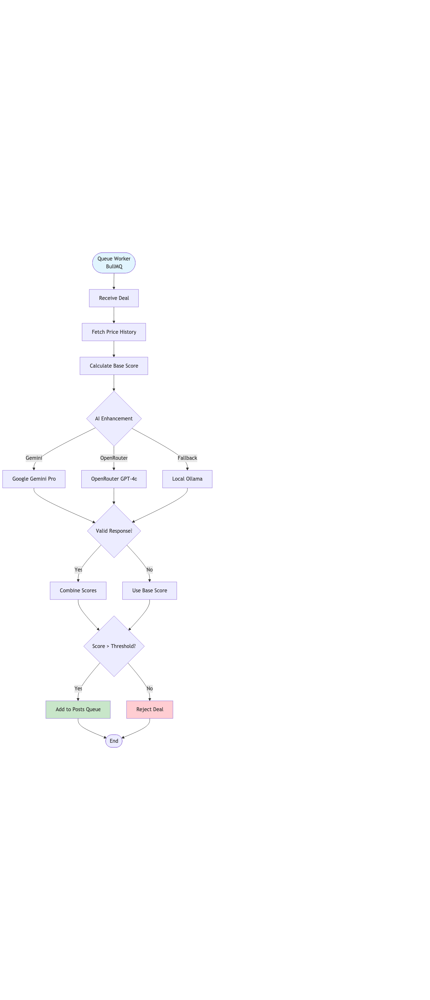


**AI Scoring Pipeline:**

| Stage | Model | Purpose | Fallback |
|-------|-------|---------|----------|
| Primary | Gemini 2.0 Flash | Deal quality assessment | OpenRouter |
| Secondary | OpenRouter GPT-4o | Price validation | Gemini |
| Local | Ollama (Llama 3) | Offline processing | None |

**Score Components:**
- Base Score: Discount percentage, price history, category demand
- AI Boost: Quality assessment, market trends, seasonal relevance
- Final Score: Weighted combination (70% base + 30% AI)

### 4.3 Telegram Posting Agent


**Content Strategy Engine:**


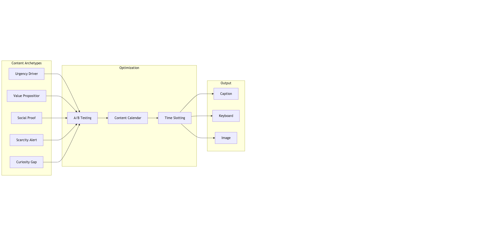


### 4.4 Curated Lists Agent


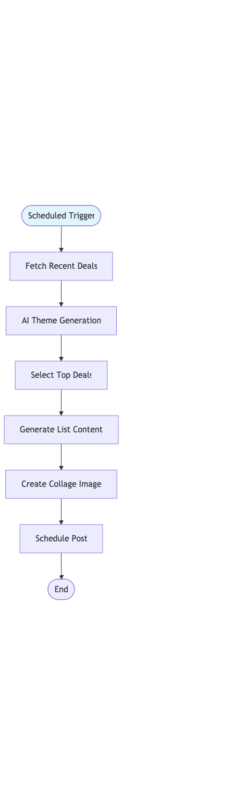


**Digest Schedule:**
- Morning Digest: 8:00 AM IST
- Afternoon Digest: 12:00 PM IST
- Evening Digest: 6:00 PM IST

---

## 5. Data Flow

### 5.1 End-to-End Deal Flow


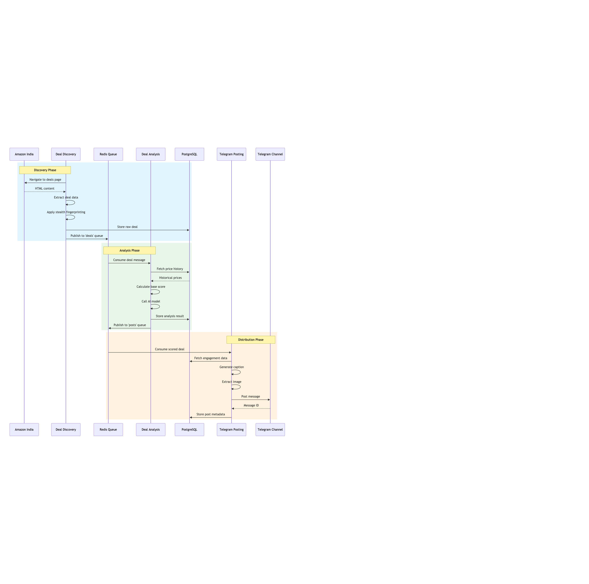


### 5.2 WhatsApp Ingestion Flow


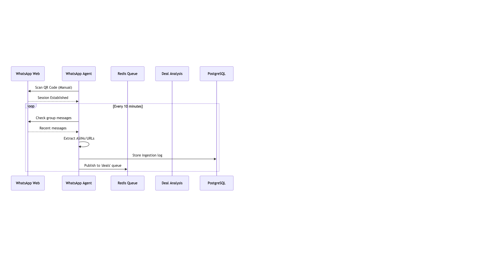


### 5.3 A/B Testing Flow


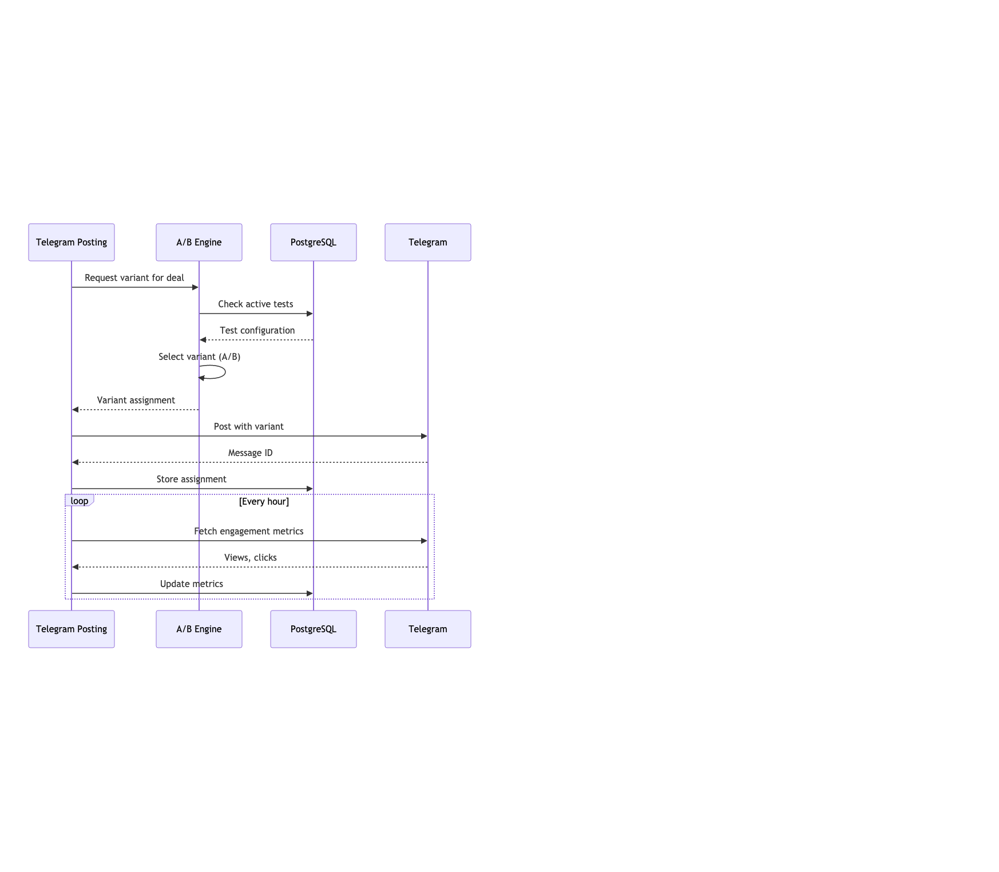


---

## 6. Database Schema

### 6.1 Entity Relationship Diagram


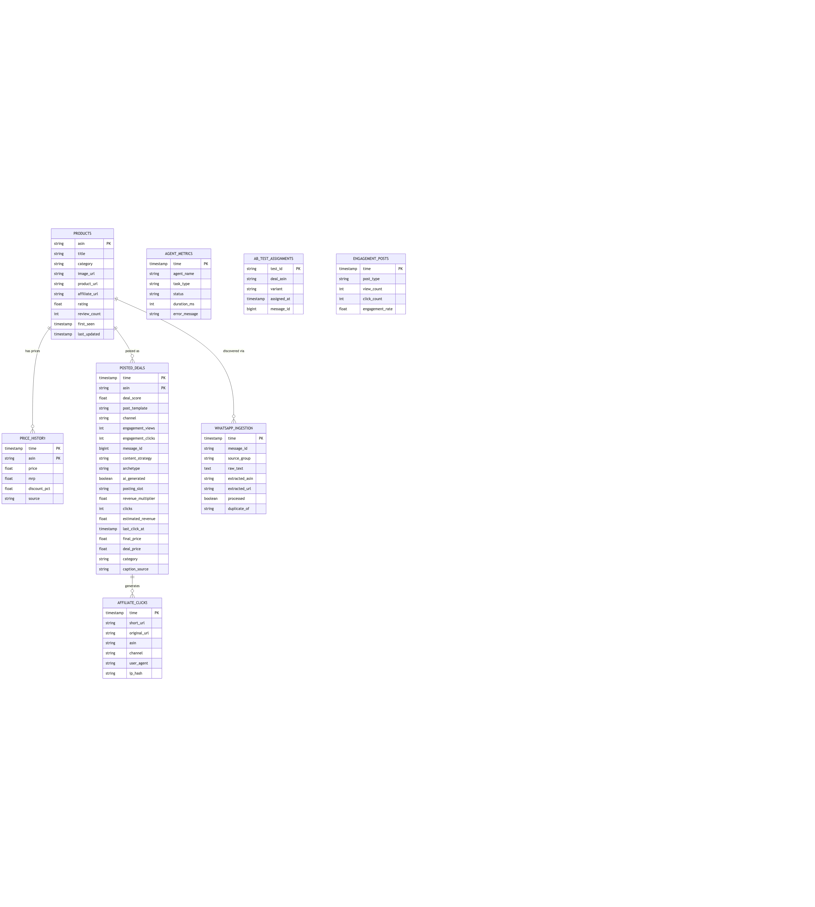


### 6.2 Schema Details

#### Products Table
| Column | Type | Constraints | Description |
|--------|------|-------------|-------------|
| asin | TEXT | PRIMARY KEY | Amazon Standard Identification Number |
| title | TEXT | NOT NULL | Product title |
| category | TEXT | | Product category |
| image_url | TEXT | | Primary product image |
| product_url | TEXT | | Amazon product URL |
| affiliate_url | TEXT | | Generated affiliate link |
| rating | REAL | | Customer rating (1-5) |
| review_count | INTEGER | | Number of reviews |
| first_seen | TIMESTAMPTZ | DEFAULT NOW() | First discovery timestamp |
| last_updated | TIMESTAMPTZ | DEFAULT NOW() | Last update timestamp |

#### Price History Table (TimescaleDB Hypertable)
| Column | Type | Constraints | Description |
|--------|------|-------------|-------------|
| time | TIMESTAMPTZ | NOT NULL | Price snapshot timestamp |
| asin | TEXT | NOT NULL | Product ASIN |
| price | REAL | NOT NULL | Current price |
| mrp | REAL | | Maximum retail price |
| discount_pct | REAL | | Calculated discount percentage |
| source | TEXT | DEFAULT 'amazon' | Price source |

#### Posted Deals Table (TimescaleDB Hypertable)
| Column | Type | Constraints | Description |
|--------|------|-------------|-------------|
| time | TIMESTAMPTZ | NOT NULL | Post timestamp |
| asin | TEXT | NOT NULL | Product ASIN |
| deal_score | REAL | | AI-calculated deal score |
| post_template | TEXT | | Template used |
| channel | TEXT | DEFAULT 'telegram' | Distribution channel |
| engagement_views | INTEGER | DEFAULT 0 | View count |
| engagement_clicks | INTEGER | DEFAULT 0 | Click count |
| message_id | BIGINT | | Telegram message ID |
| content_strategy | TEXT | | Strategy archetype |
| archetype | TEXT | | Content archetype |
| ai_generated | BOOLEAN | | AI-generated flag |
| posting_slot | TEXT | | Time slot category |
| revenue_multiplier | REAL | | Revenue optimization factor |

---

## 7. Deployment Architecture

### 7.1 Docker Compose Topology


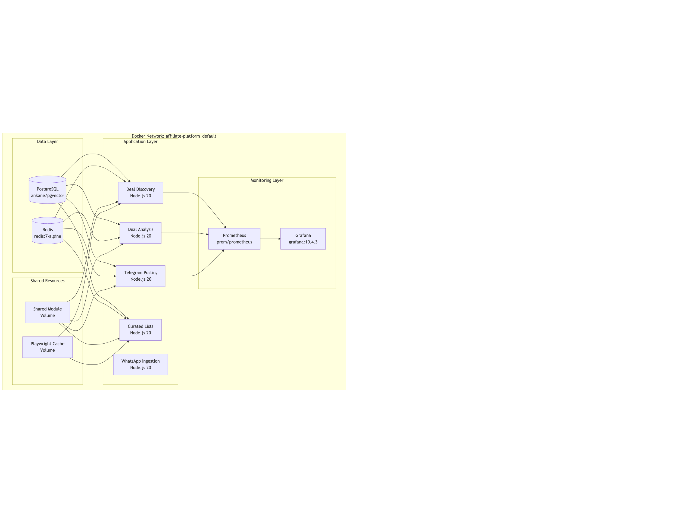


### 7.2 Service Configuration

| Service | Image | Memory Limit | Restart | Ports |
|---------|-------|--------------|---------|-------|
| PostgreSQL | ankane/pgvector:latest | Unlimited | unless-stopped | 5432 |
| Redis | redis:7-alpine | 512MB | unless-stopped | 6379 |
| Deal Discovery | Custom Node.js | 2GB | unless-stopped | - |
| Deal Analysis | Custom Node.js | 1GB | unless-stopped | - |
| Telegram Posting | Custom Node.js | 1GB | unless-stopped | - |
| Curated Lists | Custom Node.js | 2GB | unless-stopped | - |
| WhatsApp | Custom Node.js | 1GB | no (manual) | - |
| Grafana | grafana:10.4.3 | Unlimited | unless-stopped | 3000 |
| Prometheus | prom/prometheus | Unlimited | unless-stopped | 9090 |

### 7.3 Volume Mapping

| Volume | Purpose | Persistence |
|--------|---------|-------------|
| postgres_data | Database files | Persistent |
| redis_data | Cache data | Persistent |
| grafana_data | Dashboard configs | Persistent |
| prometheus_data | Metrics storage | Persistent |
| playwright_cache | Browser binaries | Shared |
| shared_modules | Node modules | Shared |

---

## 8. Monitoring & Observability

### 8.1 Metrics Collection


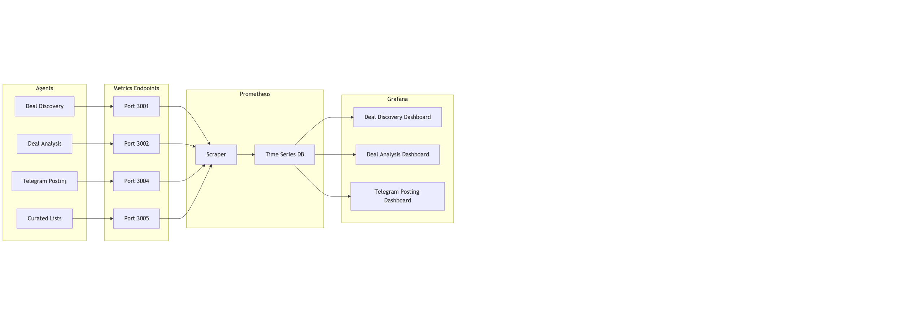


### 8.2 Key Metrics

| Category | Metric | Threshold | Alert |
|----------|--------|-----------|-------|
| Performance | Deals discovered/hour | > 50 | Warning if < 30 |
| Performance | Analysis queue depth | < 100 | Critical if > 100 |
| Performance | Post success rate | > 95% | Critical if < 90% |
| Performance | AI API latency | < 2s | Warning if > 3s |
| Health | Agent uptime | > 99% | Critical if < 95% |
| Health | Scraping error rate | < 5% | Warning if > 10% |
| Business | Engagement rate | > 10% | Warning if < 5% |
| Business | Click-through rate | > 8% | Warning if < 3% |

### 8.3 Dashboard Views

1. **Deal Discovery Dashboard**
   - Deals discovered over time
   - Source breakdown
   - Error rate by source
   - Browser fingerprint rotation

2. **Deal Analysis Dashboard**
   - Queue depth
   - AI model performance
   - Score distribution
   - Processing latency

3. **Telegram Posting Dashboard**
   - Posts per hour
   - Engagement metrics
   - A/B test results
   - Revenue estimates

---

## 9. Scaling Strategy

### 9.1 Current Phase: Single Instance


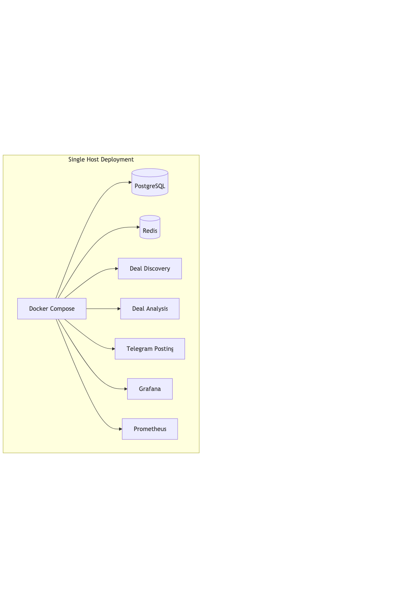


**Characteristics:**
- All services on single VPS (4GB RAM)
- Shared resources
- SQLite cache fallback
- Manual WhatsApp authentication

### 9.2 Phase 2: Horizontal Scaling


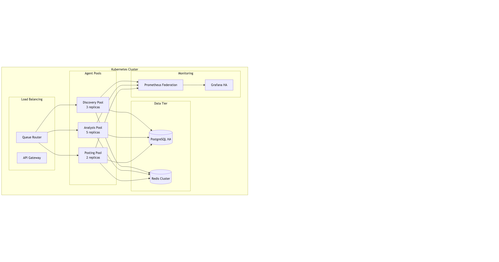


**Scaling Triggers:**
- Queue depth > 500 for 5 minutes → Scale analysis workers
- Discovery time > 15 minutes → Scale discovery workers
- Post backlog > 50 → Scale posting workers

### 9.3 Phase 3: Multi-Region Swarm


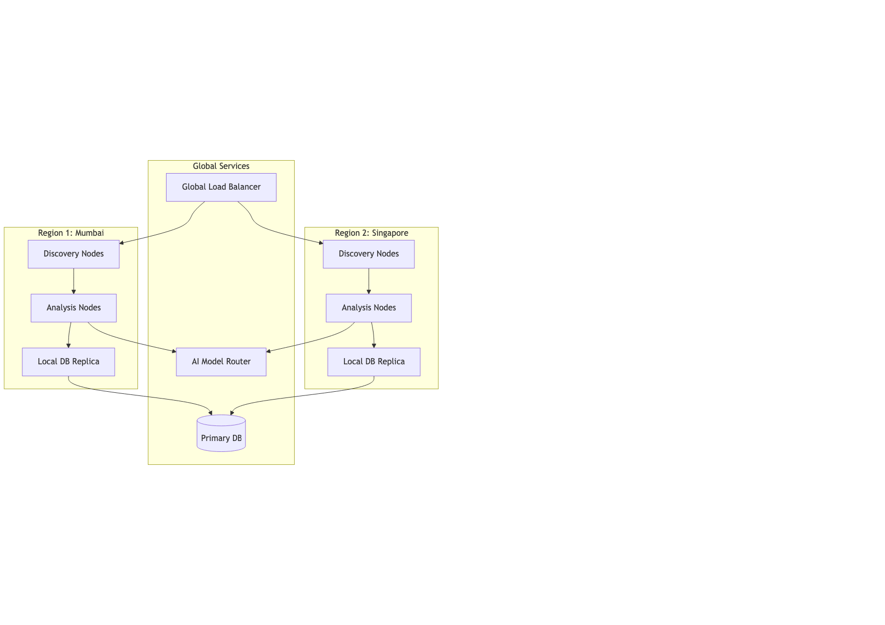


---

## 10. Security Architecture

### 10.1 Security Layers


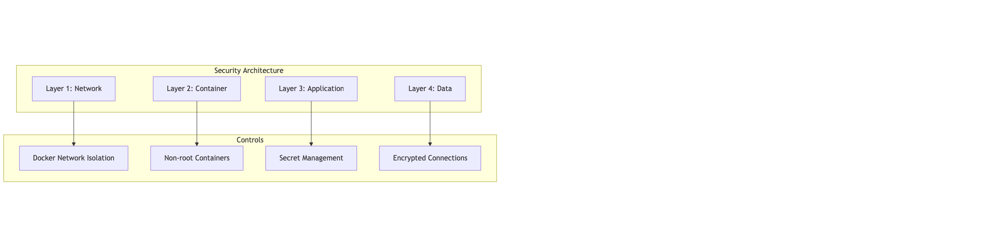


### 10.2 Security Measures

| Layer | Measure | Implementation |
|-------|---------|----------------|
| Network | Internal Docker network | Default bridge network |
| Network | Port exposure | Only necessary ports exposed |
| Container | User privileges | Non-root where possible |
| Container | Image scanning | Base images from trusted sources |
| Application | Secrets management | Environment variables only |
| Application | No hardcoded credentials | All secrets in `.env` |
| Data | Database encryption | TLS connections |
| Data | Session persistence | Encrypted session files |
| Data | API keys | Rotatable, multiple fallback keys |

### 10.3 Secret Management


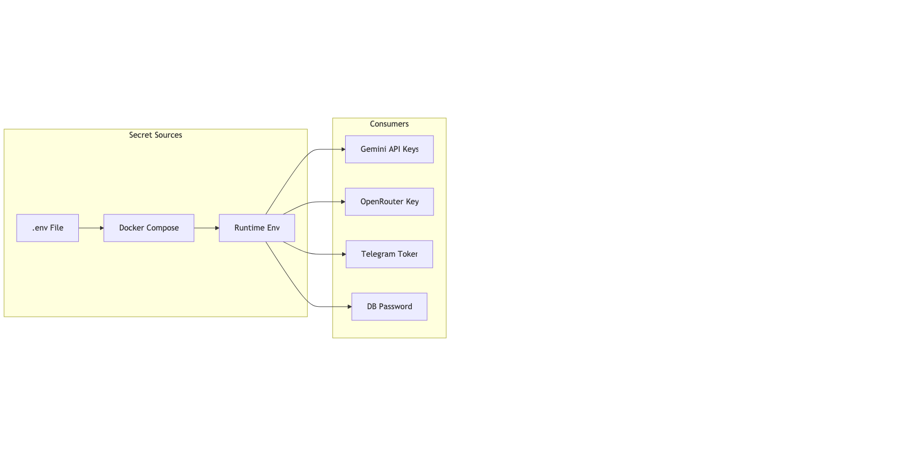


---

## 11. Technology Stack

### 11.1 Complete Stack Overview




### 11.2 Technology Details

| Category | Technology | Version | Purpose |
|----------|-----------|---------|---------|
| Runtime | Node.js | 20+ | JavaScript runtime |
| Database | PostgreSQL | 16 | Primary database |
| Extension | TimescaleDB | 2.x | Time-series data |
| Extension | pgvector | 0.5+ | Vector similarity |
| Cache | Redis | 7.x | Message queue & cache |
| Queue | BullMQ | 5.x | Job processing |
| Browser | Playwright | 1.40+ | Web scraping |
| AI | Google Gemini | 2.0 Flash | Primary AI model |
| AI | OpenRouter | - | Secondary AI model |
| AI | Ollama | - | Local AI fallback |
| Bot | Telegraf | 4.x | Telegram bot framework |
| Monitoring | Prometheus | 2.x | Metrics collection |
| Monitoring | Grafana | 10.4 | Visualization |
| Logging | Winston | 3.x | Structured logging |
| Validation | Zod | 3.x | Schema validation |
| Container | Docker | 24+ | Containerization |
| Orchestration | Docker Compose | 2.x | Local orchestration |

---

## 12. Cost Analysis

### 12.1 Current Infrastructure Costs

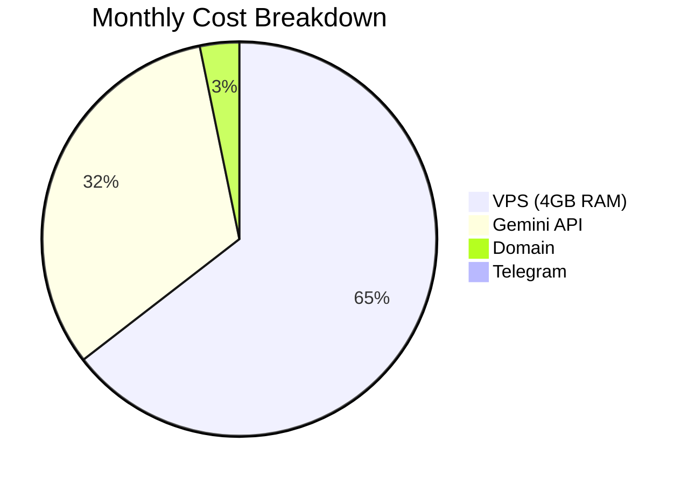

| Component | Provider | Monthly Cost | Notes |
|-----------|----------|--------------|-------|
| VPS (4GB) | Hetzner/DigitalOcean | $20 | Single instance |
| Gemini API | Google | $5-15 | Variable usage |
| OpenRouter | OpenRouter | $0-5 | Fallback usage |
| Telegram Bot | Telegram | Free | No cost |
| Domain | Namecheap/Cloudflare | $1 | Optional |
| Monitoring | Self-hosted | $0 | Prometheus/Grafana |
| **Total** | | **$26-36** | |

### 12.2 Projected Scaling Costs

| Phase | Infrastructure | Monthly Cost | Capacity |
|-------|---------------|--------------|----------|
| Phase 1 (Current) | Single VPS | $26-36 | 1,200 deals/day |
| Phase 2 (K8s) | 3-node cluster | $150-200 | 10,000 deals/day |
| Phase 3 (Multi-region) | 2 regions | $400-600 | 50,000 deals/day |

### 12.3 Cost Optimization Strategies

1. **AI Model Routing**: Use cheaper models for simple tasks
2. **Caching**: Redis caching reduces API calls
3. **Batch Processing**: Process deals in batches where possible
4. **Smart Scheduling**: Post during high-engagement hours only
5. **Image Optimization**: Compress images before posting

---

## Appendix A: File Structure

```
affiliate-platform/
├── agents/
│   ├── affiliate-system/
│   ├── curated-lists/
│   ├── deal-analysis/
│   ├── deal-discovery/
│   ├── quality-control/
│   ├── scheduler/
│   ├── telegram-posting/
│   └── whatsapp-ingestion/
├── shared/
│   ├── models/
│   ├── types/
│   └── utils/
├── infrastructure/
│   ├── db/
│   │   └── init/
│   ├── docker/
│   ├── grafana/
│   │   ├── dashboards/
│   │   └── datasources/
│   ├── monitoring/
│   └── prometheus/
├── scripts/
├── tests/
├── docker-compose.yml
└── .env
```

## Appendix B: API Integration Points

| Service | Endpoint | Purpose | Rate Limit |
|---------|----------|---------|------------|
| Google Gemini | generativelanguage.googleapis.com | Deal scoring | 60 RPM |
| OpenRouter | openrouter.ai/api | Fallback AI | 20 RPM |
| Telegram | api.telegram.org | Bot API | 30 MSG/s |
| Amazon India | amazon.in | Deal discovery | N/A (scraping) |

## Appendix C: Operational Runbooks

### Restarting Services
```bash
docker compose restart [service-name]
```

### Viewing Logs
```bash
docker compose logs -f [service-name]
```

### Database Backup
```bash
docker compose exec postgres pg_dump -U affiliate_user affiliate_platform > backup.sql
```

### Redis Queue Inspection
```bash
docker compose exec redis redis-cli LLEN bull:deals:wait
docker compose exec redis redis-cli LLEN bull:posts:wait
```

---

**Document Control**

| Version | Date | Author | Changes |
|---------|------|--------|---------|
| 1.0 | Nov 2024 | System | Initial architecture |
| 2.0 | Dec 2026 | System | Added curated lists, A/B testing, content strategy |

**Review Schedule:** Quarterly

**Distribution:** Internal Engineering Team

---

*This document contains proprietary information. Unauthorized distribution is prohibited.*
